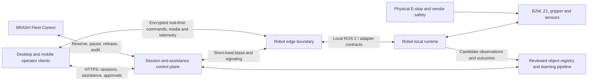
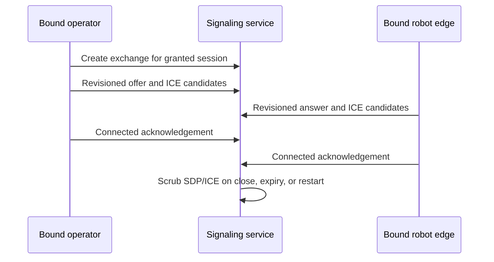
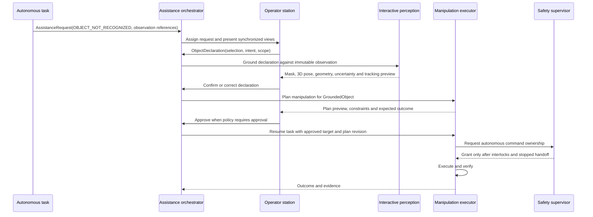
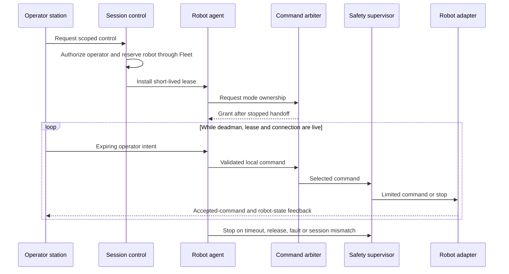
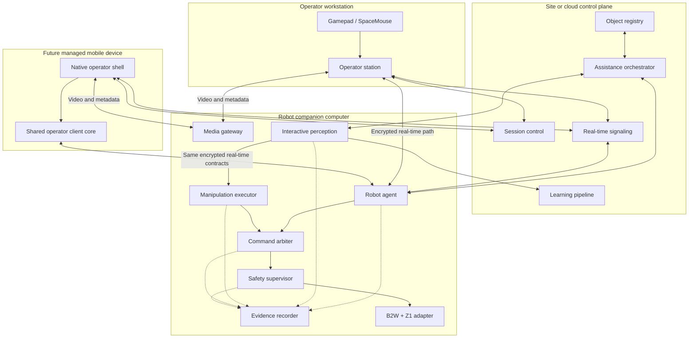

# System Architecture

**Status:** Implemented simulation foundation and proposed production
deployment architecture. Canonical contracts, durable domain state, operator
console, control/edge test APIs, independent base/Z1 safety, deterministic RGB-D
grounding, simulated manipulation, reviewed enrollment, future recognition,
identity-bound WebRTC signaling, immutable observation previews, and
failure/restart tests are executable. The
HTTP edge command endpoint remains test-only and no physical robot command path
is enabled.

## 1. Scope

The system assists an autonomous robot when human judgment is required. The
first supported platform is a Unitree B2W with a Z1 arm and gripper.

The primary workflow is interactive autonomy:

1. Autonomy reports that an object is unknown, ambiguous, unlocalized, or has
   no valid grasp.
2. An operator declares the target and manipulation intent using live sensor
   observations.
3. Robot-local perception grounds and tracks the declaration in 3D.
4. Robot-local manipulation generates and validates a plan.
5. The operator reviews the plan when policy requires approval.
6. The robot executes and verifies the result autonomously.

Direct base or arm teleoperation remains available when semantic assistance is
insufficient, subject to the same session ownership and local safety authority.

Out of scope for the first release:

- Simultaneous base and arm teleoperation.
- Automatic online modification of production recognition models.
- Unsupervised promotion of operator labels to a global object catalog.
- Public-WAN ROS 2 or DDS transport.
- Replacing a physical emergency stop or a safety-rated controller.
- Coordinated whole-body manipulation on a moving quadruped.

## 2. Context and trust boundaries



Trust rules:

- The operator and control plane are outside the robot safety boundary.
- The edge agent authenticates sessions but cannot override robot-local safety.
- Only the robot-local arbiter can grant an actuator command source ownership.
- The session service never sends commands directly to hardware.
- Session activation and stopped release use fresh, lease-revision-bound robot
  readiness reports; operator clients cannot self-attest ownership.
- The Fleet system never interprets `cmd_vel`, arm joints, or vendor packets.
- The object registry is not consulted in the final safety loop; loss of the
  registry must not prevent a local stop.

## 3. Architectural planes

### 3.1 Control plane

The control plane handles relatively low-rate, durable coordination:

- Authentication and authorization.
- Exclusive session leases.
- Ed25519 command-authority signing and live-lease recovery.
- Fleet mission pause/reservation/release.
- Assistance requests and operator assignment.
- Object-declaration submission and plan approval.
- Audit events and durable workflow state.
- Signaling needed to establish a real-time peer connection.

The control plane may be temporarily unavailable while the robot safely stops
or continues an already authorized, robot-local atomic operation according to
policy. It never maintains motor-control timing.

Every production command-authorizing lease is signed by the control plane.
Desktop and mobile clients may relay that envelope but cannot change its robot,
operator, scope, revision, or expiry. Robot edge verifies against a configured
public-key ID before installation; transport authentication and signaling state
do not substitute for this authority check.

### 3.2 Real-time data plane

The operator station and edge agent exchange:

- Expiring base, arm, and gripper intent commands.
- Deadman and clutch state.
- Robot state, safety state, and accepted-command feedback.
- Raw video and optional depth-derived views.
- Perception annotations as timestamped metadata.
- Network quality and observation-age measurements.

Commands contain a session ID, monotonically increasing sequence, production
time, expiry, requested mode, and deadman state. The robot agent restamps
arrival using its monotonic clock. Late, duplicated, reordered, wrong-session,
or unauthorized commands are rejected. DDS is restricted to the robot/site
network and is not the remote transport.

#### Operator client boundary

Desktop, browser, and future native mobile applications are clients of the same
control and real-time planes. They do not receive separate mobile actuator APIs.
The shared operator-client core converts normalized inputs into canonical,
expiring commands and locally requires foreground/unlocked state, a live channel,
acknowledged ownership, robot-safety enablement, deadman, and manipulator clutch.

Client gating is defense in depth, not the stop authority. Losing focus,
backgrounding, screen lock, OS interruption, network handoff, or input-device
loss clears client input and closes the command stream. A disappearing client
does not rely on delivering a final zero packet; the edge heartbeat and
robot-local watchdog stop motion. Foreground return and reconnection always
remain in hold until deadman is observed released and then pressed again.

The installable PWA supports assistance, observation, plan approval, and session
setup without offline state caching or direct motion. A native mobile shell is
required before direct phone/tablet control is qualified because it must bind
platform lifecycle, secure storage, real-time media, input, and device policy.

#### WebRTC signaling boundary



Every signaling message is bound to one exchange and session, a peer role, a
short freshness window, and an idempotency digest. The control plane validates
that an offer is from the session operator and an answer is from that robot's
edge identity. It bounds SDP, candidates, message count, duration, and clock
skew. Audit events intentionally omit SDP and ICE payloads.

`CONNECTED` means both peers report a transport connection. It does not make a
teleoperation session `ACTIVE`, install a lease at the edge, grant actuator
ownership, enable robot safety, or prove media/command health. Those remain
separate acknowledged transitions.

### 3.3 Perception and autonomy plane

Robot-local perception owns synchronized observations, prompted segmentation,
2D-to-3D grounding, pose uncertainty, and tracking. It publishes scene facts;
it does not directly command actuators.

The manipulation executor consumes a grounded object and task intent, then
owns grasp generation, reachability, collision checks, execution, and outcome
verification. A human declaration identifies the intended target but never
bypasses planning or safety validation.

### 3.4 Safety plane

The robot-local command arbiter and safety supervisor remain authoritative when
the operator, network, edge agent, control plane, perception process, or Fleet
system fails. Physical safety remains a separate hardware/vendor layer.

Command priority is:

```text
physical/vendor safety
    > robot-local protective stop or fault
    > authorized local service control
    > active direct-teleoperation lease
    > autonomous executor
    > no owner / stopped
```

Priority does not imply automatic takeover. Every ownership transition must
pass through a stopped, acknowledged handoff state.

### 3.5 Evidence and observability plane

A bounded edge recorder captures high-rate command, state, perception,
execution, timing, and optional policy-approved media evidence without entering
the command or stop timing path. Control-plane services record durable session,
assistance, review, and promotion decisions. Correlation and causation IDs link
both sides. Evidence export is asynchronous and storage pressure sheds optional
media before critical ownership/safety events.

## 4. Unknown-object assistance flow



### 4.1 Immutable observation references

An operator selection is made against a specific camera frame or synchronized
observation bundle. The declaration stores that observation ID, sensor frame,
timestamp, calibration version, and selection geometry. It must never be
silently applied to a newer image.

The gateway retains the selected RGB-D bytes under bounded memory, verifies
their recorded hashes at retrieval, and issues only short-lived scoped media
grants after operator authorization. The web/mobile assistance client bounds
the image response, verifies its provenance headers and SHA-256, and maps touch
or pointer selections back to source-image coordinates. If retention expires,
the UI reports the observation unavailable rather than substituting live video.

In the local Compose profile, a robot-authenticated low-rate worker observes
this same revisioned workflow. It advances only robot-owned grounding,
planning, outcome, and verification transitions; operator assignment,
declaration, and exact plan approval remain operator-owned pauses. Its executor
accepts only the simulation adapter. A physical implementation must replace its
in-memory execution receipt with a durable robot-local operation journal and
retain independent command ownership and safety gates.

### 4.2 Instance grounding versus enrollment

Instance grounding answers, “which physical object is the target now?” It is
short-lived and invalidated when tracking, calibration, or scene confidence is
lost.

Enrollment answers, “should similar objects be recognized in future tasks?” It
creates a candidate artifact containing reviewed observations, semantic labels,
features, geometry, affordances, and outcomes. Promotion to a site or global
catalog occurs through a versioned offline process with rollback.

## 5. Direct teleoperation flow



For the first robot profile, base and arm ownership are mutually exclusive. Arm
mode requires the base to be stopped in a validated stance. Releasing or losing
a session leaves the robot stopped; reconnection does not resume motion.

## 6. State machines

### 6.1 Session lifecycle

```text
REQUESTED
  -> GRANTED
  -> CONNECTING
  -> ACTIVE
  -> HOLDING
  -> RELEASED

REQUESTED | GRANTED | CONNECTING | ACTIVE | HOLDING
  -> EXPIRED | REVOKED | FAULTED
```

- `GRANTED` means authorization exists; it does not mean actuators are enabled.
- `ACTIVE` requires a valid lease, live real-time channel, valid deadman input,
  and robot-local ownership.
- Returning from `HOLDING` requires a fresh deadman edge and robot acknowledgement.

### 6.2 Assistance lifecycle

```text
OPEN
  -> ASSIGNED
  -> DECLARATION_PENDING
  -> GROUNDING
  -> PLAN_PENDING
  -> APPROVAL_PENDING
  -> EXECUTING
  -> VERIFYING
  -> RESOLVED

Any non-terminal state -> CANCELLED | EXPIRED | FAILED | DIRECT_TELEOP_REQUIRED
```

### 6.3 Grounded-object lifecycle

```text
PROVISIONAL -> GROUNDED -> TRACKED -> CONSUMED
                       \-> LOST | STALE | INVALIDATED

GROUNDED or CONSUMED -> ENROLLMENT_CANDIDATE -> REVIEWED -> PROMOTED
                                              \-> REJECTED
```

## 7. Canonical contracts

The shared contract package owns schemas for:

- `RobotCapabilities`
- `TeleopSessionLease`
- `TeleopCommandEnvelope`
- `BaseMotionIntent`, `ArmMotionIntent`, and `GripperIntent`
- `AcceptedCommandState` and `SafetyState`
- `AssistanceRequest`
- `ObservationBundleReference`
- `ObjectDeclaration`
- `GroundedObject`
- `ManipulationPlanPreview` and `ManipulationApproval`
- `ManipulationOutcome`
- `ObjectEnrollmentCandidate`

Contract rules:

- IDs are globally unique and immutable.
- Commands are short-lived and non-replayable.
- Perception data includes sensor frame, timestamp, calibration version,
  uncertainty, source algorithm, and source version.
- Approval references the exact plan revision being approved.
- Compatibility is additive within a major version; breaking changes require a
  new major version and adapter conformance suite.
- Durable events use idempotency keys and preserve causation/correlation IDs.

## 8. Safety invariants

1. A remote command cannot directly address hardware.
2. At most one source owns a given actuator group.
3. Stale commands and stale object poses are rejected locally.
4. Loss of deadman, lease, control channel, arbiter heartbeat, or safety input
   triggers the robot-profile safe response within a measured deadline.
5. Restart or reconnection never restores motion automatically.
6. Operator selection cannot override collision, reachability, payload,
   stability, workspace, joint, speed, or vendor limits.
7. Perception overlays never replace access to timestamped raw observations.
8. An unconfirmed mask or ambiguous 3D grounding cannot enter execution.
9. Losing object tracking during approach pauses or aborts according to the
   validated manipulation policy.
10. Physical emergency stop behavior is independent of this software stack.
11. All ownership, rejection, stop, declaration, approval, execution, and
    learning-promotion decisions are auditable.

Numerical stop deadlines and motion limits belong to a versioned robot profile
and must be established by hazard analysis and physical measurement. They are
not universal architecture constants.

## 9. Deployment model



The edge deployment starts and stops independently of the control plane, uses
explicit health checks, and defaults to no actuator owner. Secrets and session
credentials are installed at runtime, never committed in robot profiles.

## 10. Dependency rules

- `packages/contracts` and `packages/scene-model` depend on no executable app.
- Operator and control-plane components depend on canonical contracts, never
  ROS or Unitree types.
- The robot adapter depends inward on adapter interfaces and outward on vendor
  APIs; vendor types do not cross the adapter boundary.
- Interactive perception publishes scene facts and cannot publish actuator
  commands.
- The manipulation executor cannot bypass command arbitration or safety.
- The learning pipeline cannot directly activate a production artifact.
- Media transport and evidence recording cannot grant command authority.
- Operator client packages cannot depend on ROS/vendor types and cannot replace
  edge validation, command arbitration, or robot-local safety.

## 11. Existing-system integration

### BRASH Fleet Control

Required integration operations are semantic and low-rate:

- Request/confirm robot reservation for human assistance.
- Pause or checkpoint an active mission.
- Publish teleoperation availability and session status.
- Release the robot only after it is stopped and task state is reconciled.
- Record operator, reason, duration, and outcome in the audit stream.

The client-side implementation uses the dedicated
[`Fleet Teleoperation Hold API`](../api/fleet-teleoperation-openapi.yaml). A
session ID is the idempotency key for its hold. Grant remains fail-closed until
Fleet reports `ROBOT_STOPPED`; release uses the last observed Fleet revision.
Mission cancellation and robot quarantine are not valid handoff substitutes.

### BRASH Quadruped Controller

The B2W + Z1 adapter reuses the controller's namespaced ROS graph, state,
transforms, sensors, base velocity gate, and opt-in arm controller. The current
base guard should remain the last software gate while a session-aware arbiter,
acceleration limiting, stop-reason state, and equivalent Z1 guard are added.

## 12. First end-to-end acceptance slice

The first architecture-complete slice is simulation-only:

1. An autonomous pick task publishes `OBJECT_NOT_RECOGNIZED`.
2. An authorized operator opens the immutable RGB-D observation.
3. The operator selects and confirms one object instance.
4. Perception returns a tracked 3D object with visible uncertainty.
5. Manipulation returns a collision-checked grasp preview.
6. The operator approves the exact plan revision.
7. The simulated Z1 executes while the simulated base remains locked.
8. Verification records success or returns a new assistance request.
9. A reviewed, evaluated exemplar is activated for an explicit site/capability.
10. The next matching instance is recognized without another human declaration.
11. Replaying any stale declaration, approval, command, or pose is rejected.
12. Process restart restores durable workflows but never restores motion authority.
13. Mobile background, screen-lock, network-loss, and restart events clear input
    and require a fresh deadman edge after recovery.

Physical hardware is a later acceptance environment, not a shortcut around
this slice.
